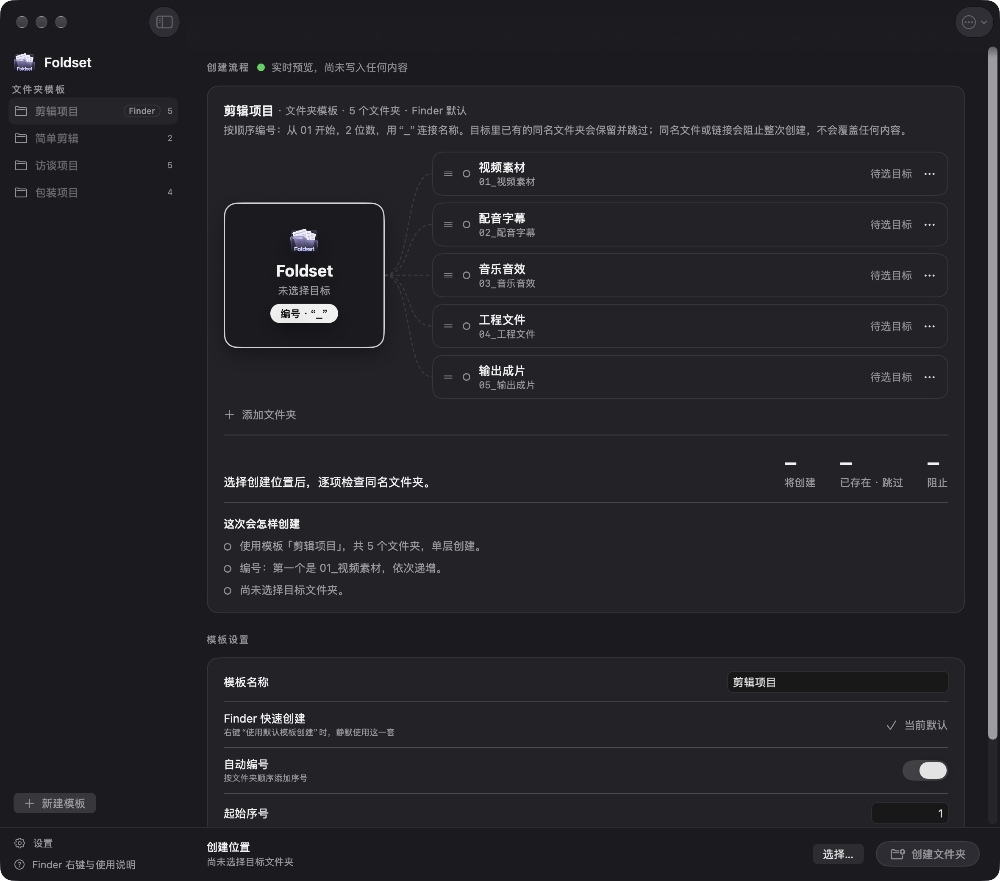

# Foldset

为创作，整理好开场。



Foldset 是原生 macOS 文件夹模板工具。把剪辑、访谈、包装等项目里反复出现的目录结构保存成模板，一键在 Finder 中创建；可选的 DaVinci Resolve 扩展还能用同一套模板创建媒体夹，并帮助整理素材使用状态。

- 完全离线运行，无账号、无网络请求、无第三方依赖。
- 界面为简体中文。

## 系统要求

- Apple Silicon Mac（M 系列芯片）。当前构建不支持 Intel Mac。
- macOS 14 或更高版本。
- DaVinci Resolve 扩展为可选功能，已在 DaVinci Resolve Studio 21.1 上验证；免费版和其他版本尚未验证。

## 下载与安装

1. 在 [Releases](https://github.com/Lunomakes/Foldset/releases) 页面下载最新版本，推荐 `Foldset-<版本>-arm64.dmg`。
2. 双击打开 dmg，把 `Foldset.app` 拖到窗口中的“Applications”文件夹，然后推出磁盘映像。如果下载的是 `.zip`，双击解压后把 `Foldset.app` 拖到“应用程序”文件夹。
3. 首次打开时会被系统拦截（见下一节），按步骤放行一次即可。

每个安装包都附有 `.sha256` 文件，可用 `shasum -a 256 <文件名>` 核对下载是否完整。

### 首次打开提示“无法验证开发者”

Foldset 没有使用 Apple Developer ID 签名，也没有经过 Apple 公证，所以 macOS 会阻止首次打开。确认文件来自本仓库的 Releases 后：

1. 双击 `Foldset.app`，在提示框中点“完成”（不要点“移到废纸篓”）。
2. 打开“系统设置 → 隐私与安全性”，滚动到“安全性”部分。
3. 找到关于 Foldset 的提示，点“仍要打开”，再输入登录密码确认。

之后即可正常打开。也可以在终端中移除下载隔离标记：

```bash
xattr -dr com.apple.quarantine /Applications/Foldset.app
```

## 使用

1. 在左侧选择模板，或新建一套。可改名、复制、删除模板，并指定默认模板。预置剪辑项目、简单剪辑、访谈项目、包装项目四套模板。
2. 设置编号开关、起始数字、编号位数和分隔符；填写文件夹名称。拖动每行左侧手柄可排序。
3. 选择目标文件夹，检查右侧预览，点击“创建文件夹”（⌘Return）。文件夹直接创建在目标位置，不会多套一层模板名。

### Finder 右键创建

在 Finder 中右键一个文件夹，选择“服务 → Foldset：按模板创建…”或“Foldset：使用默认模板创建”。后者用带星标的默认模板静默创建，只在失败时提示。

如果右键菜单里没有这两项，打开“系统设置 → 键盘 → 键盘快捷键 → 服务”检查是否已启用。

### DaVinci Resolve 扩展（可选）

扩展随 App 携带，默认不安装。在 Foldset 的“设置 → 扩展 → DaVinci Resolve”中安装、检查、更新或卸载；安装、更新和卸载前需先退出 Resolve。安装后从 Resolve 的“工作区 → 脚本 → Foldset”使用：

- 直接点模板名称，在当前选中的媒体夹下创建子媒体夹。
- “Finder 使用状态标记”：扫描当前项目的素材，按已使用、未使用候选、待核实写入 Finder 标签，并支持筛选、批量移动和移到废纸篓。

“未使用候选”只针对当前项目和所选范围，不代表其他项目或外部工具没有引用，请在删除前自行核对。Foldset 只会把文件移到废纸篓，从不永久删除。详见 [Resolve 集成说明](Integrations/DaVinciResolve/README.md)。

## 安全与数据

- 已存在的同名文件夹会跳过；同名文件或符号链接会阻止整组创建。中途失败时保留已创建的目录和原有素材，不会自动删除或回滚。
- 名称不能为空，不能包含斜杠、冒号或控制字符，也不能是隐藏目录。
- 模板保存在 `~/Library/Application Support/XuXia/templates.json`。删除模板只删除设置，不影响已创建的文件夹。模板库无法读取时会报错并保护原文件，不会自动覆盖。
- Resolve 扩展的日志与备份位于 `~/Library/Application Support/Foldset/Resolve/`。

## 卸载

1. 如安装过 Resolve 扩展，先在 Foldset 的“设置 → 扩展 → DaVinci Resolve”中卸载。
2. 把 `/Applications/Foldset.app` 移到废纸篓。
3. 如需同时删除模板和日志，再删除 `~/Library/Application Support/XuXia` 和 `~/Library/Application Support/Foldset`。

## 从源码构建

需要 Xcode Command Line Tools（`swiftc`）和 Python 3，不依赖 Xcode 工程或第三方包。

```bash
zsh scripts/test.sh
```

```bash
zsh scripts/build.sh
```

构建产物位于 `output/Foldset.app`，使用本地临时签名（ad-hoc）。运行 `zsh scripts/package.sh` 会重新构建，并在 `output/Release/` 生成发布用的 zip、dmg 和对应的 `.sha256`。更多技术细节见 [项目介绍](项目介绍.md)。

## Windows 版（预览）

`windows/` 下是 Windows 10/11 版本（C# + WinUI 3），目前只有核心功能：编辑模板、预览并创建文件夹。暂无资源管理器右键菜单、DaVinci Resolve 扩展和自动更新。

- 下载：CI 每次构建都会产出 `Foldset-windows-x64.zip`（解压后运行 `Foldset.exe`，无需安装运行时）。程序未签名，首次运行时 SmartScreen 会提示，点“更多信息 → 仍要运行”。
- 模板保存在 `%APPDATA%\Foldset\templates.json`，格式与 macOS 版相同，可直接拷贝过来使用。
- 除 macOS 版的规则外，名称还不能包含 `\ * ? " < > |`，不能以点或空格结尾，也不能是 `CON`、`NUL`、`COM1` 等系统保留名。

从源码构建需要 .NET 10 SDK：

```powershell
dotnet run --project windows/Foldset.Core.Tests
dotnet publish windows/Foldset.App -c Release -r win-x64 -p:Platform=x64 -o output/windows/Foldset
```

核心库和测试也能在 macOS 上用 .NET SDK 运行；界面只能在 Windows 上构建。

## 许可证

[MIT](LICENSE)
